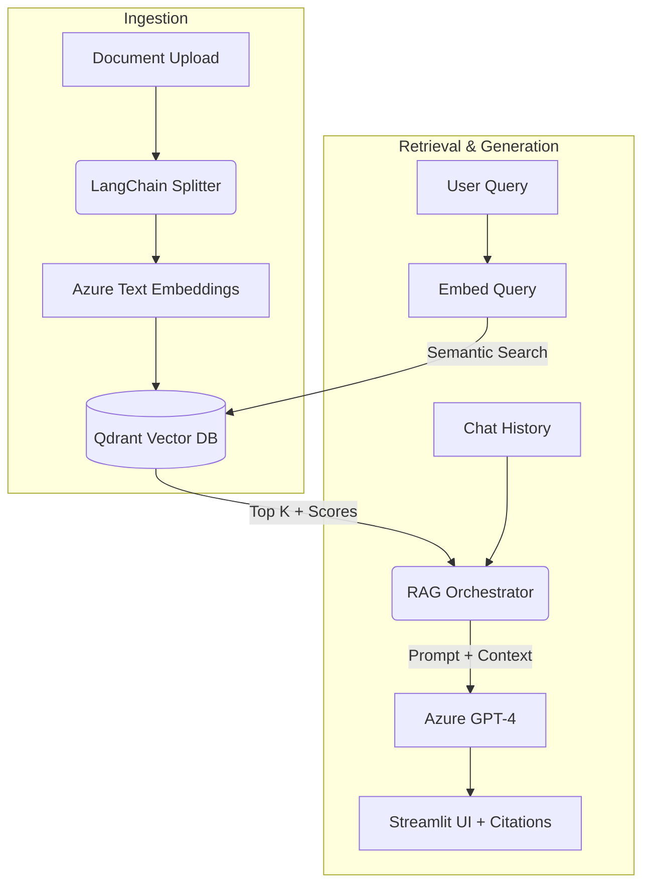

# Enterprise RAG Engine


A context-aware AI assistant that chats with private documents (PDF, DOCX, TXT, MD) using Azure OpenAI and a local Qdrant vector database. Built to demonstrate secure data ingestion, semantic retrieval, and hallucination-free generation with exact source citations.

## System Architecture



## Core Features
* **Strict Grounding:** Answers are generated *only* from ingested documents.
* **Traceability:** Every response includes exact chunk references and vector similarity scores.
* **Auto-healing DB:** Dynamically recreates Qdrant collections if embedding dimensions change.
* **System Telemetry:** Real-time health checks for the LLM, embeddings, and database connections.

## Local Setup

**1. Clone & Install**
```bash
git clone [https://github.com/YOUR_USERNAME/enterprise-rag-engine.git](https://github.com/YOUR_USERNAME/enterprise-rag-engine.git)
cd enterprise-rag-engine
python -m venv venv
source venv/bin/activate  # Windows: venv\Scripts\activate
pip install -r requirements.txt
```

**2. Configure Environment**
Create a `.env` file in the root:
```env
AZURE_OPENAI_ENDPOINT="[https://your-resource.openai.azure.com/](https://your-resource.openai.azure.com/)"
AZURE_OPENAI_API_KEY="your-api-key"
AZURE_OPENAI_DEPLOYMENT_NAME="gpt-4"
AZURE_OPENAI_EMBEDDING_DEPLOYMENT_NAME="text-embedding-ada-002"
QDRANT_COLLECTION_NAME="rag_documents"
```

**3. Run**
```bash
streamlit run app.py
```

## Production Roadmap
This repository serves as a functional MVP. For a production deployment, the following architectural upgrades are planned:
* **Decoupling:** Migrate the frontend to React/Next.js and serve the RAG pipeline via a FastAPI backend.
* **Async Ingestion:** Route heavy document processing through Celery/Kafka message queues.
* **Cloud Infrastructure:** Swap local Qdrant for managed Qdrant Cloud or Azure AI Search.
* **Multi-tenancy & RBAC:** Implement metadata-level filtering in Qdrant for user-specific access control.